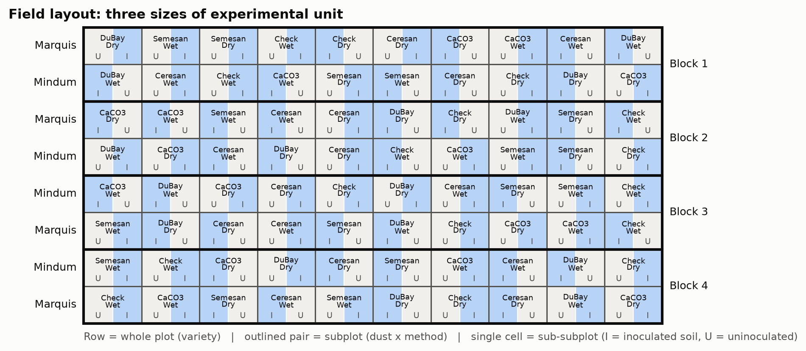
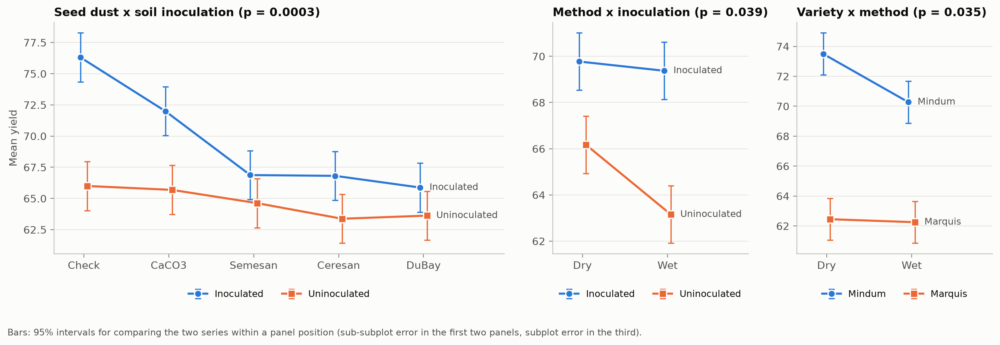
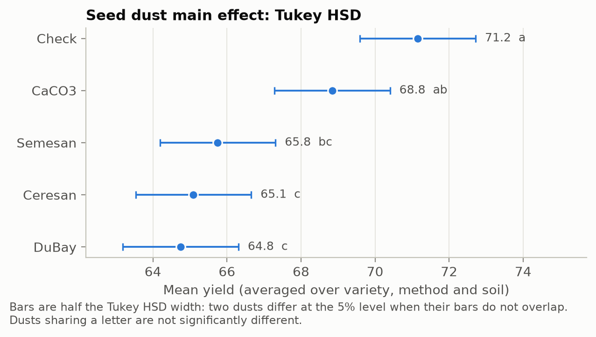
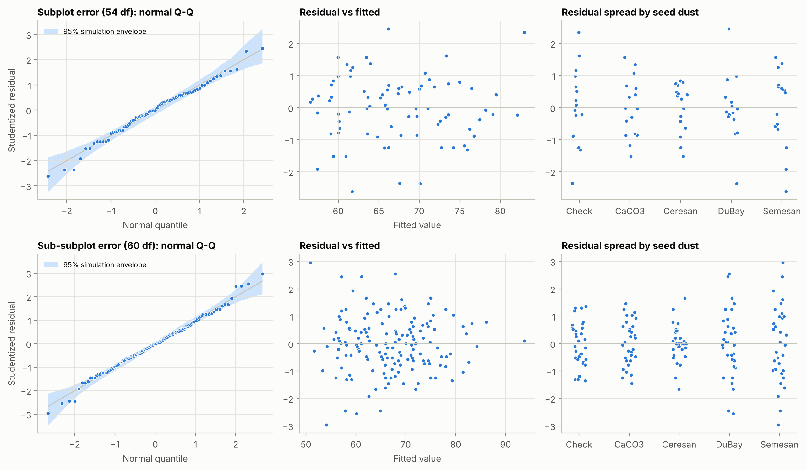

# STAT 406 Project Part 2: seed treatment, variety and soil inoculation in wheat

Initial prototype. A four-factor split-split-plot experiment analysed in Python, with every model
assumption checked and the classical ANOVA compared against a REML mixed model.

**Status:** dataset chosen, analysis and figures run end to end from one command. Slides, team number and
names are not done yet. See [Open items](#open-items).

## Why this dataset

Thirteen designed experiments were put through one identical set of assumption checks
([SCREENING.md](SCREENING.md)). This one is the only candidate that has four real treatment factors,
more than one size of experimental unit, and clean residuals on the original scale.

| Project requirement | This dataset |
|---|---|
| At least four predictors, interactions not counted | Variety, seed dust, application method, soil inoculation (blocks are extra) |
| Numerical or binary response | Plot yield, 160 plots, no missing values |
| "Different sizes of experimental units, random effects, blocks" | Three sizes of unit (whole plot, subplot, sub-subplot) in 4 blocks, so three error terms |
| Check all assumptions | All checks pass in both testable error strata (table below) |
| Say which levels differ | Seven significant effects, including three interactions, with follow-up comparisons |
| Program and data that run directly | `python analysis.py` reads `data/goulden_splitsplit.csv` and rewrites everything in `outputs/` |
| Compare a course method with one outside the course | Split-split-plot ANOVA next to a REML mixed model (they agree to 0.01%) |

## The experiment

Dominion Rust Research Laboratory, Canada, 1932. The study asked how wheat variety, seed-treatment dust, the way
the dust was applied, and inoculating the soil with the root-rot organism affect the crop.

| Factor | Levels | Applied to |
|---|---|---|
| Variety (`gen`) | Marquis, Mindum | Whole plot: half a block (8 whole plots) |
| Seed dust (`dust`) | Check (none), CaCO3, Ceresan, DuBay, Semesan | Subplot: one tenth of a whole plot (80 subplots) |
| Application method (`dry`) | Dry, Wet | Subplot, crossed with dust (10 dust-method treatments) |
| Soil (`inoc`) | Inoculated, Uninoculated | Sub-subplot: half a subplot (160 sub-subplots) |
| Block (`block`) | B1 to B4 | |

Response: `yield`, plot yield (the source does not state the units). `row` and `col` give the field position.



Source: C. H. Goulden (1939), *Methods of Statistical Analysis*, 1st ed., Wiley, pp. 151-159 (Table 39),
distributed as `goulden.splitsplit` in the R package [agridat](https://kwstat.github.io/agridat/reference/goulden.splitsplit.html)
and downloaded as CSV from [Rdatasets](https://vincentarelbundock.github.io/Rdatasets/).

## Model

$$
\begin{aligned}
y_{ijklm} = \mu &+ \rho_i + \alpha_j + \eta_{ij} \\
&+ \beta_k + \gamma_l + (\beta\gamma)_{kl} + (\alpha\beta)_{jk} + (\alpha\gamma)_{jl} + (\alpha\beta\gamma)_{jkl} + \varepsilon_{ijkl} \\
&+ \delta_m + (\alpha\delta)_{jm} + (\beta\delta)_{km} + (\gamma\delta)_{lm} + \dots + (\alpha\beta\gamma\delta)_{jklm} + e_{ijklm}
\end{aligned}
$$

- $i = 1..4$ blocks, $j = 1,2$ varieties, $k = 1..5$ dusts, $l = 1,2$ methods, $m = 1,2$ soil conditions.
- $\rho_i$ block effect; $\alpha, \beta, \gamma, \delta$ fixed effects of variety, dust, method and inoculation, with all their interactions.
- $\eta_{ij} \sim N(0, \sigma_1^2)$ whole-plot error, $\varepsilon_{ijkl} \sim N(0, \sigma_2^2)$ subplot error,
  $e_{ijklm} \sim N(0, \sigma_3^2)$ sub-subplot error, all independent.
- Assumptions: normal errors with constant variance within each stratum, independence between units of the same
  size, and additive block effects.

Each effect is tested against the error of the unit it was randomised to: variety against Error (1) with 3 df,
dust and method terms against Error (2) with 54 df, everything involving inoculation against Error (3) with 60 df.

## Run it

```bash
pip install -r requirements.txt
```

```bash
python analysis.py
```

Takes about 20 seconds. Tested with Python 3.12, numpy 2.5, pandas 3.1, scipy 1.18, statsmodels 0.15, matplotlib 3.11.
`Rscript crosscheck.R` is an optional cross-check in base R; its output is saved in `outputs/r_crosscheck.txt`.

## Results

Full log: [outputs/results.txt](outputs/results.txt).

### ANOVA

| Stratum | Term | df | SS | MS | F | p |
|---|---|---|---|---|---|---|
| Blocks | Blocks | 3 | 989.5 | 329.84 | | |
| Whole plots | **Variety** | 1 | 3638.6 | 3638.56 | 16.86 | 0.026 |
| | Error (1) | 3 | 647.6 | 215.87 | | |
| Subplots | **Dust** | 4 | 987.6 | 246.90 | 12.59 | <0.0001 |
| | **Method** | 1 | 117.3 | 117.31 | 5.98 | 0.018 |
| | Variety x Dust | 4 | 146.7 | 36.67 | 1.87 | 0.129 |
| | **Variety x Method** | 1 | 91.5 | 91.51 | 4.66 | 0.035 |
| | Dust x Method | 4 | 46.2 | 11.54 | 0.59 | 0.673 |
| | Variety x Dust x Method | 4 | 148.1 | 37.02 | 1.89 | 0.126 |
| | Error (2) | 54 | 1059.2 | 19.62 | | |
| Sub-subplots | **Inoculation** | 1 | 965.3 | 965.31 | 62.72 | <0.0001 |
| | Variety x Inoculation | 1 | 0.3 | 0.31 | 0.02 | 0.888 |
| | **Dust x Inoculation** | 4 | 379.8 | 94.95 | 6.17 | 0.0003 |
| | **Method x Inoculation** | 1 | 68.9 | 68.91 | 4.48 | 0.039 |
| | Variety x Dust x Inoculation | 4 | 119.4 | 29.85 | 1.94 | 0.116 |
| | Variety x Method x Inoculation | 1 | 3.9 | 3.91 | 0.25 | 0.616 |
| | Dust x Method x Inoculation | 4 | 25.8 | 6.45 | 0.42 | 0.794 |
| | Four-factor interaction | 4 | 7.7 | 1.92 | 0.12 | 0.973 |
| | Error (3) | 60 | 923.4 | 15.39 | | |

The script checks these sums of squares against the table printed in Goulden (1939, p. 157): all 17 published
lines match to within 0.14 (rounding in the hand calculation), and `aov` and `nlme::lme` in R give the same F statistics.

### What differs

- **Variety.** Mindum outyields Marquis by 9.5 (95% CI 2.1 to 16.9). The interval is wide because this test has only 3 error df.
- **Seed dust.** Untreated Check seed has the highest mean (71.2), then CaCO3 (68.8), then Semesan (65.8), Ceresan (65.1)
  and DuBay (64.8). Tukey HSD: Check is higher than Semesan, Ceresan and DuBay; CaCO3 is higher than Ceresan and DuBay;
  Semesan, Ceresan and DuBay do not differ from each other. Check exceeds the average of the four dusts by 5.0 (CI 3.3 to 6.8).
- **Dust x inoculation.** Inoculated soil yields more than uninoculated soil by 10.3 for Check and 6.3 for CaCO3
  (both p < 0.0001 after Bonferroni), but only by 2.3 to 3.4 for Semesan, Ceresan and DuBay (not significant).
  Equivalently, Check beats every dust on inoculated soil and none of them on uninoculated soil.
- **Method x inoculation.** The inoculation effect is 6.2 with wet application and 3.6 with dry.
- **Variety x method.** Dry application beats wet by 3.2 for Mindum (p = 0.004) and by 0.2 for Marquis (not significant).





### Mixed model comparison

A linear mixed model with random intercepts for block, whole plot and subplot, fitted by REML in `statsmodels`,
gives variance components 2.85 (block), 9.81 (whole plot), 2.11 (subplot) and 15.39 (residual). These equal the
method-of-moments values from the ANOVA mean squares, and the Wald F statistics match the ANOVA F statistics to
within 0.01%, as theory says they should for balanced data. One practical note: statsmodels' default optimiser
(L-BFGS) stops short of the optimum on this model; the script uses BFGS, which reaches the same answer as R.

### Assumption checks

Residuals from a fitted model are not independent of each other, so textbook p-values for residual tests are off.
Each p-value below is calibrated by pushing 5,000 simulated normal error vectors through the same residual-forming
matrix and ranking the observed statistic among them.

| Error stratum | Assumption | Statistic | p |
|---|---|---|---|
| Subplot (54 df) | Normality | Shapiro-Wilk W = 0.987 | 0.59 |
| | Equal variance | Brown-Forsythe over 7 groupings, worst is block (max/min variance 2.4) | 0.24 |
| | Variance vs mean | Spearman of abs. residual with fitted = -0.02 | 0.90 |
| | Outliers | Largest studentized residual 2.61 | 0.50 |
| | Additivity | Tukey one-df test | 0.31 |
| Sub-subplot (60 df) | Normality | Shapiro-Wilk W = 0.993 | 0.49 |
| | Equal variance | Brown-Forsythe over 11 groupings, worst is block (max/min variance 3.9) | 0.066 |
| | Variance vs mean | Spearman of abs. residual with fitted = -0.01 | 0.94 |
| | Outliers | Largest studentized residual 2.97 | 0.18 |
| | Additivity | Tukey one-df test | 0.30 |
| | Independence | Correlation of residuals in neighbouring field plots, z = +0.24 | 0.81 |



Things to say honestly on the slides:

- **Whole-plot error has 3 df.** Eight whole plots are too few to test normality or equal variance at that level,
  so the variety test rests on the randomisation and on the assumption, not on a diagnostic.
- **Block-to-block variance** in the sub-subplot stratum is the closest call: p = 0.011 for that grouping alone,
  0.066 after allowing for the 11 groupings examined.
- **Box-Cox** on the sub-subplot stratum gives lambda = 1.85 with 95% interval 1.05 to 2.0, which just excludes 1
  (no transformation). Repeating the ANOVA on yield squared keeps all seven significant terms significant; the only
  change is that Variety x Dust moves from p = 0.129 to p = 0.043.

## Open items

1. Add team number and names; build the 8-minute slide deck from the figures and tables in `outputs/`.
2. Ask the instructor or TA whether a REML mixed model counts as the "method not part of the course" for the comparison.
3. The direction of two effects is counter-intuitive for a root-rot study: inoculated soil and untreated seed both
   yield more. The data match Goulden's printed totals, so this is in the source, not a coding error. He presents
   the example for the method and the excerpt read so far gives no agronomic explanation. Worth one sentence on a slide.
4. "Dry" and "Wet" Check plots received no dust; their difference (2.6, p = 0.11) is consistent with noise.

## Repository layout

```
analysis.py           main analysis: ANOVA, mixed model, assumption checks, comparisons, figures
doetools.py           projection-based multi-stratum ANOVA and simulation-calibrated residual tests
crosscheck.R          optional cross-check in base R
data/                 goulden_splitsplit.csv
outputs/              results.txt, tables (CSV) and figures (PNG) written by analysis.py
screening/            how the dataset was chosen: 13 candidates, same checks for each
SCREENING.md          screening method, table and decision
```
